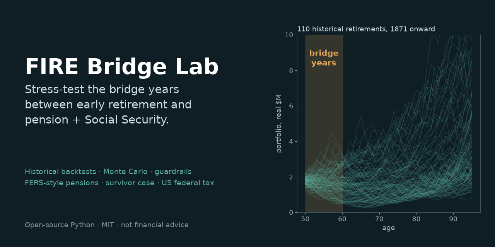

# FIRE Bridge Lab



[](LICENSE)  [](https://mybinder.org/v2/gh/madisonicus/firebridgelab/main?labpath=notebooks%2F04-what-if-experiments.ipynb)

*Stress-test the bridge years: backtests, Monte Carlo and guardrails from early retirement to pension and Social Security.*

A free, open-source lab for people planning **FIRE** (Financial Independence, Retire Early) who want to model and experiment with the risk in their plan. Change the variables (retirement age, spending, asset mix, pensions, Social Security and when you claim it, part-time work, a spouse dying first, fees, taxes) and see how each one moves your odds across every historical retirement since 1871 and thousands of Monte Carlo scenarios.

It is built for the common FIRE situation where you stop working years before guaranteed income starts: the portfolio has to carry everything during those **bridge years**, then only the gap that pensions and Social Security don't cover.

**Educational software, not financial advice.** It shows how a plan behaved under past and simulated markets, given your assumptions. Consult a qualified advisor before acting.

## Try it in 2 minutes

No Python needed for the first two. The [FAQ for non-programmers](docs/faq.md) walks through each.

**1. In your browser, nothing to install.** [](https://mybinder.org/v2/gh/madisonicus/firebridgelab/main?labpath=notebooks%2F04-what-if-experiments.ipynb)
opens the worked notebooks in JupyterLab on [Binder](https://mybinder.org), a free public
service. The first launch takes a few minutes while it builds and downloads the return data.
Start with [04 · What-if experiments](notebooks/04-what-if-experiments.ipynb), change the plan at the top, and choose **Run → Run All Cells**.

**2. The web app on your computer, with Docker.** One line builds the image from GitHub and starts it:

```bash
docker build -t firebridgelab https://github.com/madisonicus/firebridgelab.git#main && docker run --rm -p 127.0.0.1:8000:8000 firebridgelab
```

Then open <http://127.0.0.1:8000/>, pick a household from **Examples…**, or describe your own under **Household & income streams**, and press **Recompute**. **Download plan** saves your scenario as a plan file the command line runs too.

**3. The command line, with Python 3.11 or newer.**

```bash
pipx install "git+https://github.com/madisonicus/firebridgelab"   # or pip install
firebridgelab-fetch-data             # the public return data, once (about 10 MB)
firebridgelab init my-plan.toml      # a commented starter plan: edit it
firebridgelab run my-plan.toml       # deterministic, historical and Monte Carlo
```

## Examples gallery

Six fictional households ship as plan files. Load them from the web app's **Examples…** menu,
or copy one with `firebridgelab init --example <name> my-plan.toml`. The
[gallery](docs/examples.md) shows each one's story, its plan file and what `firebridgelab run`
prints for it.

| Example | The story |
| --- | --- |
| `deferred-federal-couple` | Both left federal service at 50; deferred pensions frozen until 62, then the FERS COLA; taxes modeled. |
| `mra10-single` | A federal retiree at MRA with a 25% reduced annuity, no COLA until 62. |
| `leanfire-single` | Retired at 40 on $45k a year, no pension, Social Security at 70, guardrails. |
| `ss-only-couple-age-gap` | No pensions, a five-year age gap, a glidepath, and a survivor case. |
| `part-time-bridge` | Consulting to 55, marketplace health insurance to 65, taxes modeled. |
| `rental-and-pension` | A pension with a 50% survivor benefit and a rental sold at 75. |

## What it models

What you can vary:

- **When:** retirement age, plan horizon, pension start ages, Social Security claiming ages (62–70, with the exact SSA adjustment)
- **How much:** starting portfolio, annual spending, a spending floor and ceiling, a lifecycle "go-go / slow-go / no-go" taper
- **Spending rule:** constant, Guyton-Klinger-style guardrails, funded-ratio rules, or an amortization (VPW-style) frontier
- **Household:** one or two people with their own ages and planning horizons; any number of income streams (pensions, Social Security, annuities, part-time work, rental, other) each with its own start and end age, COLA rule (full, none, a fixed percentage, or FERS-style), survivor fraction and tax treatment; one-off cash events such as a home sale or a car; required spending over an age range such as pre-Medicare healthcare or a mortgage; and a survivor case
- **Markets:** asset mix across up to 12 asset classes (five need optional data you download yourself), historical replay or Monte Carlo (Normal or fat-tailed), fees, and authored stress scenarios
- **Taxes:** taxable, tax-deferred and Roth balances, with 2026 US federal brackets, capital gains, RMDs and the pre-59½ penalty; Social Security taxed by the provisional-income formula; optional payroll tax, Medicare IRMAA, a Roth conversion policy, and state income tax for the no-tax and flat-rate states

Not yet modeled: graduated-bracket state taxes and non-US taxes; Social Security spousal benefits and the earnings test; a person's planning end age as a death (it is a horizon only; deaths come from the survivor case); and per-person retirement accounts (the 59½ and RMD ages follow the first person).

It ships as a command line that runs plans written as small text files, a Python library, worked Jupyter notebooks, and a self-hosted web UI.

## Why another FIRE calculator?

The popular free tools (cFIREsim, FIRECalc, FI Calc, ERN's SWR Toolbox) are excellent at constant-income backtests. FIRE Bridge Lab focuses on what they leave out or approximate:

- **Bridge years:** spending rules that know a pension at 60 and Social Security at 67 are coming, instead of treating them as a flat adjustment.
- **Taxes:** taxable, tax-deferred and Roth accounts, 2026 federal brackets, capital gains stacking, NIIT, RMDs and the pre-59½ penalty, solved each year.
- **Pensions as they really work:** amounts fixed in dollars until they start, FERS-style partial COLAs, survivor benefits, single-filer brackets after a first death.
- **Validated:** compared with the Trinity and Bengen studies, the Social Security regulations, IRS worked examples, the FERS COLA statute, closed-form annuity math and the independent optimizer [Owl](https://github.com/mdlacasse/Owl), each comparison cited and run as a test ([Validation](docs/validation.md)).

## Quick start with a plan file

A plan is a short [TOML](https://toml.io) file you can edit in any text editor
and keep in git. [docs/plan-files.md](docs/plan-files.md) lists every key.

```bash
pip install "firebridgelab[report] @ git+https://github.com/madisonicus/firebridgelab"
firebridgelab-fetch-data                 # the public return data, once

firebridgelab init plan.toml             # a commented starter plan; edit it
firebridgelab run plan.toml              # deterministic, historical, Monte Carlo
firebridgelab sweep plan.toml --set spending.annual=60000:90000:10000 \
                              --set income_streams.a_ss.start_age=62,67,70
firebridgelab solve plan.toml --confidence 0.9     # max sustainable spending
firebridgelab compare plan.toml plan-retire-55.toml
firebridgelab report plan.toml -o report.html      # one offline HTML file
```

`run` prints success and depletion counts, the earliest depletion age, how
often a dynamic rule hits its spending floor, spending and ending-portfolio
percentiles, lifetime tax when you give a tax split, and a
year-by-year table; add `--format json` or `--format csv` for scripts. `sweep`
runs every combination of the values you give it. Any key can be changed for
one run with `--set`, e.g. `--set people.a.start_age=55`.
`firebridgelab init --list` shows the [examples](firebridgelab/examples/), all fictional:
a deferred federal couple, an MRA+10 single retiree, a leanfire single, a
Social Security-only couple with an age gap, a part-time bridge with ACA
premiums, and rental income with a pension. `firebridgelab ui` starts the web
UI from a checkout. The web UI loads and downloads the same files.

## The example household

The built-in default household is fictional: two people aged 50 who plan to
age 95, a $1.8M portfolio, $110k a year of real spending, pensions of $24k
(from 60) and $9k (from 65), and Social Security of $33k and $26k at full
retirement age, claimed at 67 and 70.

## Ways to use it

Besides the command line above:

### 1. Library

```bash
pip install "git+https://github.com/madisonicus/firebridgelab"
firebridgelab-fetch-data      # downloads the public data (a few MB)
python -c "import firebridgelab as rm; print(rm.simulate(rm.default_scenario()).final_portfolio)"
```

Data goes to `$FIREBRIDGELAB_DATA` if set, else `data/cache/` in a source
checkout, else `~/.cache/firebridgelab`. The public API is `Scenario`,
`default_scenario`, `simulate`, `simulate_historical`, `simulate_monte_carlo`,
`solve_max_spend` and `simulate_stress`; [docs/library.md](docs/library.md) has
a quickstart.

### 2. Notebooks

Run them in the browser on [Binder](https://mybinder.org/v2/gh/madisonicus/firebridgelab/main)
with no install (the `binder/` folder holds its setup), or locally:

```bash
git clone https://github.com/madisonicus/firebridgelab
cd firebridgelab
python -m venv .venv && . .venv/bin/activate
pip install -e ".[notebooks]"
firebridgelab-fetch-data
jupyter lab notebooks/
```

| Notebook | What it shows |
| --- | --- |
| [01-historical-backtest](notebooks/01-historical-backtest.ipynb) | Trinity/Bengen-style checks: 30-year 4% withdrawals on four stock/bond mixes, success rates, failing start years, worst-cohort safe withdrawal rates, and the limits of the Shiller data. |
| [02-pension-bridge-guardrails](notebooks/02-pension-bridge-guardrails.ipynb) | A fictional early-retiree couple, written as people and income streams, bridging to pensions and Social Security: constant spending vs guardrails vs the amortization frontier, FERS-style pension options, a survivor case, fees, Student-t Monte Carlo, and the household as a plan file. |
| [03-owl-cross-check](notebooks/03-owl-cross-check.ipynb) | The same household through [Owl](https://github.com/mdlacasse/Owl), an independent optimizer, for every historical start year. |
| [04-what-if-experiments](notebooks/04-what-if-experiments.ipynb) | One fictional household, one change at a time: retirement age, spending, both together, Social Security claim age, a pension's COLA rule, and years of part-time work, with tables and charts. |

The notebooks are committed with their outputs, so they read on GitHub without
running anything.

### 3. Self-hosted web UI

The browser UI compares two scenarios side by side, and the same JSON API
serves scripts. Its **Household & income streams** section edits one or two
people and any list of income streams, cash events and required spending, plus
the tax options; **Examples…**, **Load plan** and **Download plan** read and
write the same plan files as the command line. With Docker or Podman (or the
one-line `docker build` from a URL in [Try it in 2 minutes](#try-it-in-2-minutes)):

```bash
git clone https://github.com/madisonicus/firebridgelab
cd firebridgelab
docker compose up -d
# or: podman build -t firebridgelab . && podman run -d -p 8000:8000 firebridgelab
```

Then open <http://127.0.0.1:8000/>. The image downloads the data at build time.
With compose, saved scenarios live in the `scenarios` volume.

Or from a checkout, without a container:

```bash
pip install -r requirements.txt -e ".[web]"
firebridgelab-fetch-data
firebridgelab ui              # or: uvicorn api.main:app --host 127.0.0.1 --port 8000
```

The API describes itself at `/docs`. The main endpoints are `GET`/`POST
/api/trajectory` (all three modes and stress tests), `/api/solve` (max
sustainable spend), `/api/classes`, `/api/presets`, `/api/plan/import` and
`/api/plan/export` (plan-file text to and from a POST body) and `/api/examples`. The page loads its
assets and calls the API by relative path, so it also works behind a reverse
proxy under a path prefix.

## Return modes

| Mode | Function | What it does |
| --- | --- | --- |
| Deterministic | `simulate` | One constant real return, compounded year by year. The rate is the allocation's *rebalanced* compound return: the weighted arithmetic mean less half the portfolio variance, computed from the same volatilities and correlations that Monte Carlo samples. |
| Historical | `simulate_historical` | Replays every historical cohort in the 1871–2025 Shiller data. Each cohort is a window as long as the plan (46 years for the default, ages 50–95, which gives 110 cohorts) that starts in a real calendar year. The result is a percentile fan. Multi-class allocations use the window that every selected class covers. |
| Monte Carlo | `simulate_monte_carlo` | Draws per-class returns from `Normal(arithmetic_mean, vol)`, or from a fat-tailed multivariate Student-t with the same mean, volatility and correlation. Simple returns are floored at −99%. Draws are Cholesky-correlated through a correlation matrix estimated pairwise over the longest overlap of each pair, then projected to the nearest positive semi-definite matrix. By default, 10,000 seeded trials go through the same cohort loop as Historical. |

The mean used for sampling is `compound + vol²/2`, the standard variance-drag
adjustment, so the Monte Carlo median terminal value sits close to the
deterministic one: within a few percent, and slightly below once withdrawals
add sequence risk.

**Stress tests** (`simulate_stress`) run the plan through authored adverse
return paths (1929, the 1970s, 2000–02, 2008, a valuation unwind, a
no-recovery depression) and through scenario perturbations: a 23% Social
Security cut, government-income austerity (the SS cut plus a frozen pension
COLA), a one-time +20% cost-of-living shock, and a sustained +1.5%/yr real
cost-of-living drift.

## Spending strategies

| Strategy | What it does |
| --- | --- |
| Constant | Flat real spending at every age. |
| Lifecycle | Age-anchored taper off the input level: ×1.00 to 74, ×0.85 from 75 to 84, ×0.75 from 85. |
| Guardrails | Guyton-Klinger-style capital-preservation and prosperity rules on the withdrawal rate net of guaranteed income, times the lifecycle taper, clamped to a floor and ceiling. Band, adjustment, floor and ceiling are editable. Stateful. |
| Funded ratio (smooth) | Partial adjustment toward the funded ratio (portfolio ÷ NPV of future spending gaps), α = 0.5. |
| Funded ratio (bands) | ±10% steps triggered at funded ratios of 1.20 and 0.80. |
| Funded ratio (tiers) | A fixed preset tier ladder (FLOOR $85k up to MAX $160k), with the funded ratio measured against the MAX tier. |
| Amortization frontier | Each year, the constant real spend that exactly amortizes the portfolio over the remaining horizon against the gaps left after guaranteed income. It is a maximum-consumption benchmark: unclamped, with terminal value driven toward zero. |

Constant and lifecycle are path-independent, so the max-sustainable-spend
solver works on them. The other strategies depend on the path and are not
solvable. Withdrawals can come from a single portfolio or from a three-bucket
cash / income / growth structure. The allocation can also follow a glidepath
that changes at guaranteed-income events.

## Methodology and limitations

All dollars are real, in plan-start purchasing power. Each year, the starting
balance grows by that year's real return net of `annual_fee`. Spending and
guaranteed income are both mid-year flows (each `× (1 + r/2)`). When a
tax-location split is supplied, federal tax is a year-end outflow solved by a
fixed point.

**Data.** US stocks and the 10-year Treasury proxy come from Robert Shiller's
monthly file, January to January. Its prices are monthly averages, which mute
crash years by 2–5 points against calendar-year data (2022 is −17.4% against
−23.0%). The bond class is built from the 10-year yield with a fixed duration
of 7, not from an aggregate-bond index. Other classes come from Damodaran,
Fama-French, FRED, and (optionally) Nareit and testfol.io simulated series; see
[DATA-SOURCES.md](DATA-SOURCES.md). Historical cohorts overlap heavily: 110
cohorts of 46 years amount to about three independent histories, so "% of
cohorts" is a count, not a probability.

**Pensions and Social Security.** Amounts are entered for the start age. With
`pension_nominal_until_start`, a pension is read as the nominal check at
commencement and deflated at `assumed_inflation`. This fits, for example, a US
federal (FERS-style) deferred annuity, which is fixed from separation until it
starts. `pension_cola="fers_diet"` then applies the FERS COLA rule each year it
is paid. Social Security is entered as the full-retirement-age benefit plus a
claim age (62–70). The API applies the SSA early-reduction and delayed-credit
factors, and the benefit is then constant in real terms. The survivor case
(`survivor_age`) keeps the larger of the survivor's own SS benefit and the
widow(er)'s benefit on the decedent's record, continues
`survivor_pension_fraction` of the decedent's pension, scales spending (and the
guardrail rails) by `survivor_spending_fraction`, and files single from the
death year.

**Tax.** With a tax split the accounts pay a yearly bill solved as a fixed
point. Federal brackets and deductions are the 2026 IRS tables, held constant
in real dollars; amounts the law does not index (the Social Security base
amounts, the NIIT and additional-Medicare thresholds) shrink at the assumed
inflation rate. Social Security is taxed by the provisional-income formula by
default (`tax.ss_taxation`). Options add payroll tax on work income, Medicare
IRMAA surcharges, a Roth conversion policy, and state income tax for the
no-tax and flat-rate states whose rules could be read from the state (AK, FL,
NV, NH, SD, TN, TX, WY, GA, IL, IN, IA, LA, MS, NC, PA) or a custom flat rate.
A flat taxable-gains fraction stands in for cost basis. RMDs are modelled, and
a bracket-fill lever moves extra money from tax-deferred to taxable between
ages 60 and 74. Every rule, its source and what is left out are in
[docs/methodology.md](docs/methodology.md).

**What the model does not do:** tax without a tax split, graduated-bracket
states and the flat-rate states not listed above, local income taxes, state
credits, foreign tax, automatic ACA or standard Medicare premiums (enter them
as required spending), long-term-care shocks as explicit lines, tracked cost
basis, tax on taxable-account dividends and interest, Roth five-year rules,
72(t)/SEPP access before 59½ (the penalty is applied and reported instead),
the FERS no-COLA-before-62 rule, accounts tracked per person (access ages and
RMDs follow person A), mortality-weighted horizons, and valuation-conditioned
or regime-switching returns. Monte Carlo has no autocorrelation or parameter
uncertainty. Its fixed seed means success rates carry about ±0.5 point of
sampling noise.

## Validation

[docs/validation.md](docs/validation.md) is the one place that compares the
model's numbers with published references: the Trinity (1998, 2011) and
Bengen (1994) withdrawal studies, 20 CFR 404 for Social Security claim factors
and survivor benefits, IRS worked examples and tables (Rev. Proc. 2025-32,
Pub. 915, Pub. 590-B, the capital-gain worksheet, Form 8960), 5 U.S.C. 8462
for the FERS COLA, closed-form annuity math, and a per-cohort cross-check
against Owl. Each row cites its source, states the tolerance and gives the
reason for any gap, and each is a test in
[`tests/validation/`](tests/validation/) that CI runs on every push. The page
also lists the comparisons that could not be made.

## Data sources

The library reads Robert Shiller's *Irrational Exuberance* data, Aswath
Damodaran's historical returns, the Kenneth R. French Data Library and FRED.
`firebridgelab-fetch-data` downloads them. They are not in this
repository and must not be committed, and the optional Nareit and testfol.io
series cannot be redistributed at all. [DATA-SOURCES.md](DATA-SOURCES.md) has
the terms, the citations and how to add the optional classes.

## Tests

```bash
pip install -r requirements.txt -e ".[dev]"
firebridgelab-fetch-data
python -m pytest -q tests          # library + API
python -m pytest -q -m validation tests   # only the validation suite (docs/validation.md)
node --test tests/test_*.mjs       # web modules (Node 22, no npm dependencies)
```

The default scenario's deterministic output is pinned as a canary
([ADR 0001](docs/adr/0001-byte-stable-canary-discipline.md)). Shiller revises
recent months, so the pin is exact only on the data revision recorded in
`tests/_canary.py` and holds to a relative 1e-4 on any other. The
`tests/playwright_*.mjs` scripts are optional browser checks, not part of the
suite. The settled design decisions are in [docs/adr/](docs/adr/README.md).

## Layout

```
firebridgelab/           the library (pure Python, real dollars), the data fetcher and the CLI (cli/)
firebridgelab/examples/  fictional plan files, shipped as package data
api/                     FastAPI app: parameter parsing, validation, serialization, plan files
web/                     zero-build vanilla-JS frontend
notebooks/               worked examples, committed with outputs
binder/                  the Binder environment for running the notebooks in a browser
docs/                    the documentation site's pages and architecture decision records
mkdocs.yml               the documentation site (mkdocs build --strict)
scripts/                 the data fetcher wrapper, the examples-page generator, the mkdocs hooks
tests/                   pytest and node:test suites, Playwright browser checks
```

## Documentation site

The pages in `docs/`, with this README as the home page, build into a site with
[MkDocs](https://www.mkdocs.org) and the Material theme:

```bash
pip install -e ".[docs]"
mkdocs serve                  # http://127.0.0.1:8000/, or: mkdocs build --strict
```

CI builds it on every push but does not publish it; `docs/deploy-docs-workflow.yml`
is a disabled GitHub Pages workflow for the owner to turn on.
`python scripts/build_examples_page.py` regenerates the examples gallery.

## Contributing and support

This project is provided as-is. Issues and pull requests are welcome, but no
support is promised. Tax tables are refreshed yearly while the project is
maintained. Please keep test fixtures and examples fictional.

## License

MIT; see [LICENSE](LICENSE). Data sources have their own terms; see
[DATA-SOURCES.md](DATA-SOURCES.md).
